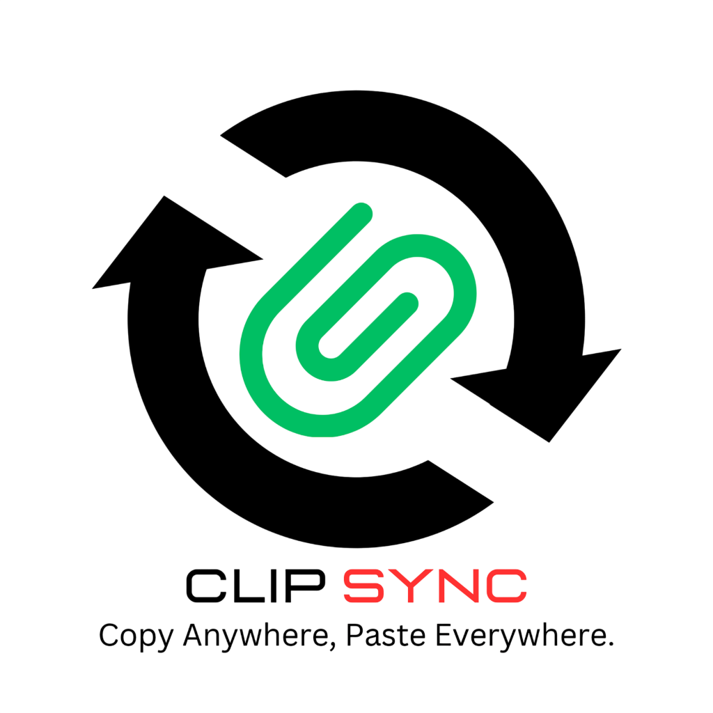
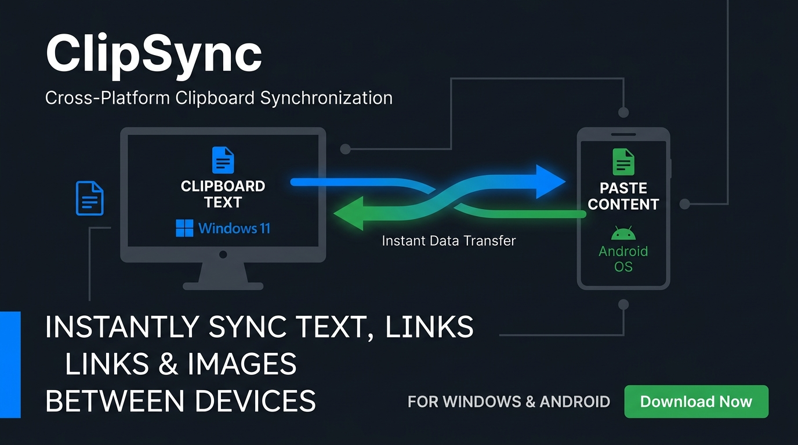
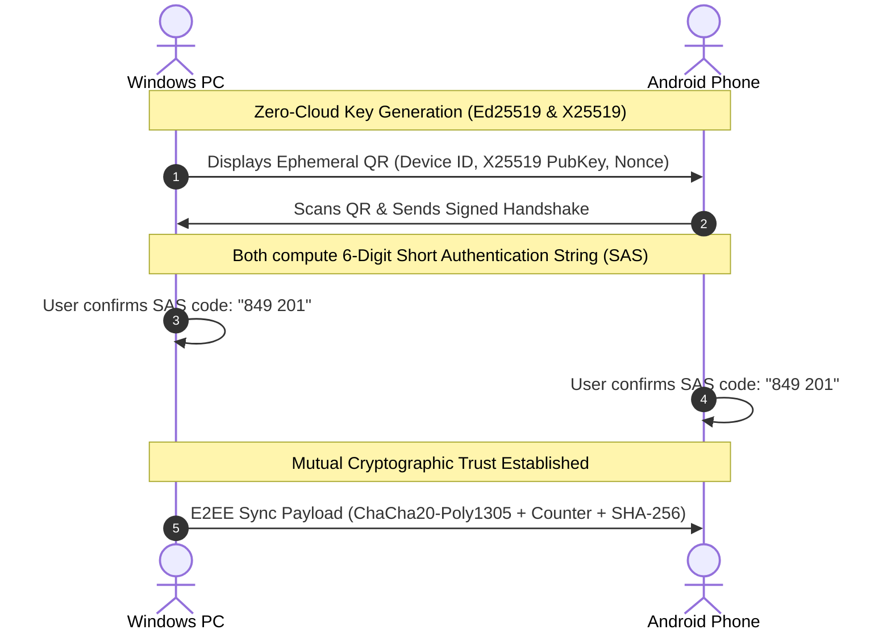

<div align="center">

  

  # 📋 ClipSync

  <!-- Animated Typing Tagline -->
  <p align="center">
    <a href="https://github.com/Rohanjm911/ClipSync">
      
    </a>
  </p>

  [](CHANGELOG.md)
  [](LICENSE)
  [](#-cyber-obsidian-glassmorphism-ui)
  [](docs/TESTING.md)
  [](docs/SECURITY.md)

  <br/><br/>

  <p align="center">
    
  </p>

  <!-- Animated Pulsing Sync Indicator Bar -->
  <p align="center">
    
  </p>

</div>

---

## ⚡ Quick Start: Ready-to-Run Binaries (Root Folder)

No setup or compilation is required to start syncing! The pre-built release binaries are available directly in the root directory:

| Platform | Binary | Size | Instructions |
| :--- | :--- | :--- | :--- |
| **Windows PC** | [`clipsync-desktop.exe`](./clipsync-desktop.exe) | `~42.1 MB` | Double-click to launch (runs in system tray/desktop) |
| **Android Phone** | [`clipsync-android.apk`](./clipsync-android.apk) | `~51.4 MB` | Transfer to phone & install (or run `adb install clipsync-android.apk`) |

---

## 🌟 Highlights & Key Features

### 🚀 First-Launch Device Naming & Zero-Trust Out-of-the-Box
- **First-Time Setup Ceremony:** Opening the app for the first time presents an interactive naming dialog with one-tap device presets (*"Work Laptop"*, *"Gaming PC"*, *"Pixel Phone"*, *"Galaxy Phone"*) or custom entry.
- **Zero Pre-Seeded Companion Devices:** Starts with zero paired devices (`activePeerCount: 0`) in an authenticated zero-trust state.
- **Pristine Empty Clipboard History:** Starts with a 100% clean, empty clipboard feed. Entries only populate in real time when you copy or sync.

### 🔄 True Real-Time Background Sync (<250ms)
- **Zero-Click Workflow:** When you copy on Windows, it is automatically available to paste on Android within 250ms, and vice-versa.
- **Echo Prevention:** Cryptographic SHA-256 loop suppression ensures your device never bounces its own copied text back in an infinite loop.

### 🔵 Offline Bluetooth Direct Sync (No Wi-Fi / Router Required!)
- **Dedicated Bluetooth Hub:** Toggle Bluetooth Sync on/off directly from the Dashboard or Settings.
- **Bluetooth Quick Action Button:** Dedicated **[🔵 Bluetooth Sync]** button in the broadcast console alongside standard LAN broadcast.
- **Bluetooth PAN Subnet Support:** Pre-configured companion presets (`192.168.44.1`, `192.168.44.2`, `172.20.10.1`) for seamless zero-router offline sync between Windows & Android over Bluetooth PAN/Tethering.
- **Dedicated Bluetooth Pairing Tab:** Switch between QR-Code pairing and Bluetooth Direct Pairing in the Pairing Ceremony view with built-in connection ping testing.

### 🏷️ Independent Device Customization & Controls
- **Custom Device Names:** Easily rename your devices in **Settings** (e.g., *"Rohan's Gaming PC"*, *"Galaxy S23 Ultra"*).
- **Per-Device Sync Toggle:** Instantly pause or resume clipboard synchronization anytime without unpairing.
- **Device Distinction:** Clear device badging distinguishes whether an entry originated from a PC, Android, or local action.

### 🎨 Cyber Obsidian Glassmorphism UI
- **Futuristic Palette:** Deep frosted obsidian backgrounds (`#0B0F19` & `#111827`) with translucent glass card borders.
- **Vibrant Accents:** Electric indigo (`#6366F1`) and sky cyan (`#38BDF8`) micro-glows.
- **Zero Overflow Guarantee:** Dynamic responsive layout tested across mobile screens down to 320px width.

### 🗂️ Rich Content Preview Cards
ClipSync's smart parser automatically formats distinct types of clipboard data:
- 🎨 **Color Swatches:** Hex (`#2563EB`, `#FF5733`) and RGB values render live color chips, glows, and RGB breakdown badges.
- 🌐 **Web Links:** Detects URLs (`http://`, `https://`) and formats them with domain pills (e.g., `github.com`) and quick open buttons.
- 💻 **Code & Shell Commands:** Formats CLI commands (`git`, `docker`, `curl`, `flutter`, `cargo`) and JSON payloads inside a dark terminal block with macOS window controls.
- 🔒 **Masked Sensitive Secrets:** Automatically detects API keys, tokens, and passwords, securely masking them with one-tap reveal/hide controls.

---

## 📶 How to Connect Your Devices

### Method 1: Local Wi-Fi (Recommended - Fastest)
1. Ensure both your PC and phone are connected to the same Wi-Fi network or hotspot.
2. Open **ClipSync** on both devices.
3. On your phone, go to **Settings** $\rightarrow$ note the **My Local IP** (e.g. `192.168.1.15:48901`).
4. On your PC, enter that IP into the **Companion Device IP** field and click **Test Ping**.
5. Once verified, simply copy anything on one device — it immediately syncs to the other!

### Method 2: Bluetooth Direct Sync (Offline / No Wi-Fi)
1. **Pair OS Bluetooth:** Pair your Android phone with your Windows PC once via Windows **Bluetooth & Devices** settings.
2. **Enable Tethering / PAN:**
   - On Android: Turn on **Bluetooth Tethering** (*Settings $\rightarrow$ Network & Internet $\rightarrow$ Hotspot & Tethering $\rightarrow$ Bluetooth Tethering*).
   - On Windows: In Bluetooth & Devices, click on your phone $\rightarrow$ **Connect using $\rightarrow$ Access point (Personal Area Network)**.
3. **Bluetooth Direct Pairing Tab:** In ClipSync, go to **Pairing Ceremony** $\rightarrow$ switch to the **🔵 Bluetooth Direct Pairing** tab.
4. **Quick Presets & Ping Test:** Select the preset chip (`192.168.44.1` for Android Gateway, `192.168.44.2` for PC) and click **"Test Bluetooth Link"**.
5. **Sync Directly:** Toggle on **Bluetooth Direct Sync Hub** on the Dashboard, or tap the dedicated **[🔵 Bluetooth Sync]** button in the broadcast box. ClipSync routes encrypted payloads over the offline Bluetooth PAN socket without needing any Wi-Fi router or internet access!

---

## 🔒 Security & Privacy Architecture

ClipSync adheres to a strict zero-cloud, privacy-first design:



- **Zero Cloud & Zero Accounts:** No accounts, logins, phone numbers, or third-party servers. All data stays strictly on your local network.
- **End-to-End Encryption:** Encrypted with **ChaCha20-Poly1305 AEAD** symmetric keys derived via Diffie-Hellman (X25519).
- **Cryptographic Trust Handshake:** Pair securely via QR code with Short Authentication String (SAS) verification against MitM attacks.
- **Instant Revocation:** Unpairing or deleting a device instantly destroys its key on your system, preventing any further sync.

---

## 🔧 Troubleshooting & Tips

### 🛡️ Windows Firewall Prompt
- On first launch, Windows Defender Firewall may display a security alert.
- Click **"Allow access"** for **Private networks** so ClipSync's internal background service can listen on TCP port `48901`.
- If sync is blocked, run this one-time command in PowerShell (Admin):
  ```powershell
  New-NetFirewallRule -DisplayName "ClipSync Local Sync" -Direction Inbound -LocalPort 48901 -Protocol TCP -Action Allow
  ```

### 🔋 Android Background Sync & Battery Optimization
- Modern Android systems aggressively sleep background apps. To guarantee continuous background sync:
  1. Go to **Settings $\rightarrow$ Apps $\rightarrow$ ClipSync**.
  2. Tap **Battery** $\rightarrow$ select **Unrestricted**.
  3. Ensure **Notifications** are allowed so ClipSync can maintain its lightweight background listener.

---

## 🛠️ Technology Stack

<p align="center">
  <a href="https://flutter.dev"></a>
  &nbsp;&nbsp;
  <a href="https://dart.dev"></a>
  &nbsp;&nbsp;
  <a href="https://www.rust-lang.org"></a>
  &nbsp;&nbsp;
  <a href="https://tauri.app"></a>
  &nbsp;&nbsp;
  <a href="https://kotlinlang.org"></a>
  &nbsp;&nbsp;
  <a href="https://www.sqlite.org"></a>
  &nbsp;&nbsp;
  <a href="https://www.android.com"></a>
  &nbsp;&nbsp;
  <a href="https://microsoft.com/windows"></a>
</p>

| Component | Technologies & Real-World Logos | Details |
| :--- | :--- | :--- |
| **Frontend & UI** |  **Flutter** &nbsp;  **Dart** | Modern Cyber-Obsidian Glassmorphism UI, cross-platform responsiveness, smooth reactive state management. |
| **Desktop Host** |  **Rust** &nbsp;  **Tauri 2** | Ultra-lightweight native Windows host, multi-threaded Tokio async runtime, tray integration, memory-safe OS clipboard interceptor. |
| **Mobile Core** |  **Android** &nbsp;  **Kotlin** | Foreground and background sync lifecycle listener, direct PAN/Tethering socket networking. |
| **Networking** |  &nbsp;  | Real-time TCP HTTP server on port `48901`, local Wi-Fi auto-discovery, zero-cloud offline Bluetooth PAN sockets. |
| **Cryptography** |  &nbsp;  | Ring, RustCrypto & PointyCastle authenticated encryption with Short Authentication String (SAS) QR pairing. |
| **Persistence** |  **SQLite 3** &nbsp;  | Local encrypted clip history, paired companion device records, zero cloud storage. |

---

## 🛠️ Building From Source

### Prerequisites
- **Flutter SDK:** 3.29.0+ / 3.47+
- **Rust & Cargo:** 1.80+ (for Windows desktop target)
- **Android SDK:** API Level 34+

### 1. Build Android APK
```bash
cd flutter_app
flutter build apk --debug --android-skip-build-dependency-validation
```
*Output: `flutter_app/build/app/outputs/flutter-apk/app-debug.apk`*

### 2. Build Windows Desktop `.exe`
```bash
# 1. Build frontend assets
cd flutter_app
flutter build web --base-href /
cp -r build/web/* ../windows/dist/

# 2. Compile release binary with Cargo
cd ../windows/src-tauri
cargo build --release
```
*Output: `windows/src-tauri/target/release/clipsync-desktop.exe`*

### 3. Run Automated Tests & Linter
```bash
cd flutter_app
flutter test       # Runs desktop & mobile viewport responsive tests
flutter analyze    # Verifies zero lint errors and sound type safety
```

---

## 📂 Project Directory Map

```
ClipShare/
├── clipsync-desktop.exe       # Pre-built Windows desktop app (Ready to launch)
├── clipsync-android.apk       # Pre-built Android package (Ready to install)
├── assets/                    # Official application branding & banner media
│   ├── logo.png               # High-res ClipSync application icon
│   └── clipsync-banner.jpg    # Project banner graphic
├── flutter_app/               # Unified Cross-Platform Flutter Application
│   ├── lib/
│   │   ├── models/            # DeviceInfo, HistoryItem, Settings models
│   │   ├── screens/           # Dashboard, History, Pairing, Settings views
│   │   ├── services/          # StateService, clipboard watcher, HTTP networking
│   │   ├── theme/             # Modern Glassmorphic Cyber Obsidian theme tokens
│   │   └── widgets/           # RichClipboardCard, FirstLaunchDialog (onboarding naming)
│   └── test/                  # Automated widget, responsiveness & smoke test suite
├── windows/                   # Desktop Host Application (Tauri 2 + Rust Core)
│   ├── src-tauri/             # Rust systems backend (Tokio thread, Arboard, SQLite)
│   └── dist/                  # Bundled production frontend distribution
├── docs/                      # Architectural, Security, and Networking deep dives
│   ├── ARCHITECTURE.md        # Detailed component breakdown
│   ├── SECURITY.md            # Cryptographic specifications & SAS pairing
│   └── NETWORKING.md          # Wi-Fi, mDNS, and Bluetooth PAN protocols
└── README.md                  # Project overview and user guide
```

---

## 📄 License

ClipSync is licensed under the **MIT License**. See [LICENSE](LICENSE) for details.

---

<!-- Animated Footer Wave -->
<p align="center">
  
</p>
